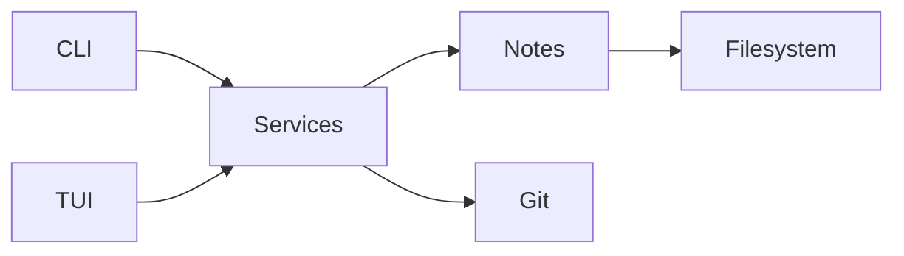

# Architecture

The filesystem is authoritative: each note is a directory named by a UTC timestamp containing `README.md`. Reads must not modify Markdown. `internal/notes` owns note discovery, parsing, relationships, and search. `internal/app` coordinates the CLI and TUI, configuration, editor and Git operations; `internal/config` loads YAML; `internal/cli` and `internal/tui` are presentation adapters. No database is required.

The graph is derived on demand from Goldmark's syntax tree and wiki references in prose; indexing is read-only. Search is an in-memory scan suitable for small collections. Configuration is resolved centrally, with explicit flags taking precedence over environment variables and YAML defaults. TUI state belongs to the presentation adapter, which uses Bubble Tea process suspension when launching editors. Filesystem and subprocess errors reach the user with context.

The source script assumes `GITUSER`, hardcodes `vim`, invokes Pandoc, and commits and pushes automatically. The rewrite must not require Git or network connectivity to read notes. Git operations should scope commits to the relevant note and avoid touching unrelated staged changes.

Current implementation status is described in README.md; this document describes boundaries, not a claim that every adapter exists.
